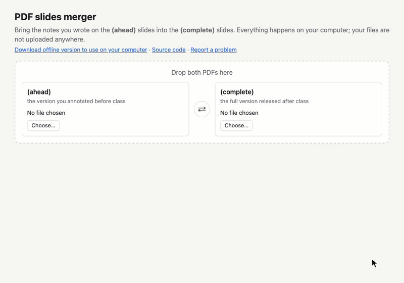

# Keynote PDF Merger

Bring the notes you wrote on the **(ahead)** slides into the **(complete)** slides.

Before class you get `Lecture (ahead).pdf`. After class you get `Lecture (complete).pdf`, which has extra slides (for example, answers to exercises). If you annotated the ahead version, this page builds a copy of the complete version with your annotated pages in it: in place of the matching clean pages, or right after them.



**Use it online: <https://chatw.ch/keynote-pdf-branch-merger/>**, or download [`docs/index.html`](docs/index.html) and double-click it to use it offline.

## For students

1. Open **<https://chatw.ch/keynote-pdf-branch-merger/>**, or double-click a downloaded copy of `docs/index.html`. It works in Chrome, Edge, Safari or Firefox. Nothing is installed and your files never leave your computer: the page reads them inside your browser and uploads nothing.
2. Drop both PDFs onto the page, or choose them with the two **Choose…** buttons. Use **⇄** if they ended up the wrong way round.
3. Check the two columns: your (ahead) pages on the left, the (complete) pages on the right.
   - Click the round button between two pages to choose what happens:
     - **Replace**: your (ahead) page takes the place of the (complete) page,
     - **Insert above** / **Insert below**: your (ahead) page goes right before / after the (complete) page, keeping both,
     - **Use the page from the right**: keep the (complete) page (the button then shows an empty circle).
   - Pages with your annotations are set to **Replace** automatically and marked with ✎.
   - Slides without annotations are folded into a bar such as "▸ 5 slides without annotations"; click it to open them.
   - A striped box on the left means that slide was not in the (ahead) version.
   - ⚠ means you had also annotated that page in the (complete) file. Those notes are lost if you replace it; choose **Insert above** or **Insert below** to keep both.
   - **?** means the two pages are not identical, usually because the slide was edited between the two versions; check that they show the same slide.
4. Change the file name if you like, then click **Download merged PDF**.

Icons: [Lucide](https://lucide.dev) (ISC License).

Only annotations your PDF app saves as annotations (most apps' default: Preview, Acrobat, PDF Expert, GoodNotes/Notability without "flatten") are detected automatically. If your app flattened your ink into the page, open the folded slides and choose pages by hand.

## For maintainers

The PDFs need to come from keynote-pdf-brancher, the lecturer's tool that exports a Keynote deck into the (ahead)/(complete) PDFs. Its newer versions stamp each page with an invisible slide ID, which this page uses to pair pages exactly. Older PDFs are paired by content instead.

```bash
npm install
npm test
npm run build   # writes docs/index.html, the page GitHub Pages serves
```

The demo GIF is recorded from the built page with mock slides (`demo/`). It needs Google Chrome and ffmpeg:

```bash
uv run --with pymupdf scripts/make_demo_slides.py   # demo/Lecture (ahead|complete).pdf
npm run demo                                        # demo/demo.gif
```

See `CLAUDE.md` for the design and its decisions.

Found a problem? [Open an issue](https://github.com/chatchavan/keynote-pdf-branch-merger/issues).

## License

[MIT](LICENSE). Bundled libraries keep their own licenses: pdf.js (Apache-2.0), pdf-lib (MIT), Lucide icons (ISC).
